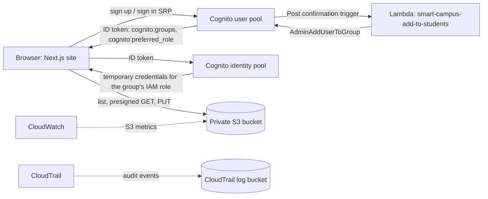

# CampusStream: AWS Setup Documentation

Everything configured in the AWS Management Console for the Smart Campus Media Hosting project (Next.js website with role-based video access). Region for every resource: **us-east-1 (N. Virginia)**.

> Replace the placeholders `<ACCOUNT_ID>`, `<USER_POOL_ID>`, `<APP_CLIENT_ID>` and `<IDENTITY_POOL_ID>` with your own values. Never commit `.env.local` or AWS access keys to the repository.

## 1. Architecture



Flow: a user signs in with Cognito, the identity pool exchanges the login for temporary AWS credentials, and the IAM role attached to the user's Cognito group decides what they can do in S3. Students are read-only, and Faculty can also upload.

## 2. Resource inventory

| Service | Resource | Purpose |
|---|---|---|
| S3 | `smart-campus-media-24bai0337` (us-east-1) | Private media bucket used by the site |
| S3 | `aws-cloudtrail-logs-<ACCOUNT_ID>-...` | CloudTrail log storage |
| Cognito user pool | `User pool - gsd7sa` | Sign-up, sign-in, groups |
| Cognito app client | `smart-campus-web` (single-page app, no secret) | Used by the website |
| Cognito groups | `Faculty` (precedence 1), `Students` (precedence 2) | Role-based access |
| Cognito identity pool | `smart-campus-identity-pool` | Temporary AWS credentials |
| IAM roles | `Faculty`, `Students`, `smart-campus-default-auth` | Permissions per group |
| Lambda | `smart-campus-add-to-students` | Adds new sign-ups to `Students` |
| CloudTrail | Trail with its own log bucket | Audit log |
| CloudWatch | Automatic S3 dashboard | Storage and request metrics |
| IAM groups | `smart-campus-admins`, `smart-campus-students` | For people using the AWS console, not website users |

The site plays videos through time-limited S3 presigned URLs.

## 3. S3 bucket

1. S3, then **Create bucket**: name `smart-campus-media-24bai0337`, region us-east-1, **Block all public access: on**.
2. Folder layout (created with **Create folder**, or implicitly on upload):
   - `Courses/CSE/CloudComputing/` (course videos)
   - `lectures/`, `projects/`, `events/`
3. **Permissions, then CORS, then Edit**. Paste:

```json
[
  {
    "AllowedOrigins": ["http://localhost:3000"],
    "AllowedMethods": ["GET", "PUT", "HEAD"],
    "AllowedHeaders": ["*"],
    "ExposeHeaders": ["ETag", "x-amz-server-side-encryption", "x-amz-request-id", "x-amz-id-2"],
    "MaxAgeSeconds": 3000
  }
]
```

Add the production site URL to `AllowedOrigins` when the site is deployed. `ETag` must be exposed for multipart uploads of large videos.

S3 paths are case-sensitive (`Courses`, not `courses`). Browsers play `.mp4` (H.264 + AAC) and `.webm` reliably.

## 4. Cognito user pool (`gsd7sa`)

| Setting | Value |
|---|---|
| Sign-in identifier | Email (phone also allowed by the pool) |
| Self-registration | Enabled (Sign-up page) |
| Verification | Cognito-assisted, email message, verify email address |
| Email sender | Send email with Cognito (default sender, about 50 emails per day) |
| MFA | No MFA |
| Required attributes | None (the site also sends `name`) |

### 4.1 App client `smart-campus-web`

1. **App clients, then Create app client**. Application type: **Single-page application (SPA)**, name `smart-campus-web`. Return URL: `http://localhost:3000`.
2. Authentication flows: `ALLOW_USER_AUTH`, `ALLOW_USER_SRP_AUTH`, `ALLOW_REFRESH_TOKEN_AUTH`. `ALLOW_USER_PASSWORD_AUTH` is off.
3. Token lifetimes: access 60 minutes, ID 60 minutes, refresh 5 days.
4. **No client secret.** A browser app cannot keep a secret. An earlier client created with a secret failed every call with `NotAuthorizedException: Client ... is configured with secret but SECRET_HASH was not received`, and secrets cannot be removed from an existing client, so a new client was created.

### 4.2 Groups

| Group | Precedence | IAM role | Meaning |
|---|---|---|---|
| `Faculty` | 1 | `Faculty` | Watch and upload videos |
| `Students` | 2 | `Students` | Watch videos only |

Group names are case-sensitive and the website checks the exact string `Faculty` in the `cognito:groups` claim.

**Approval process:** anyone can register on either portal. The post-confirmation Lambda puts every verified account in `Students`. Faculty access is granted only by an administrator: **Groups, then Faculty, then Add user to group**. Registering on the faculty page does not grant faculty rights, and the faculty page signs out anyone who is not in the `Faculty` group.

## 5. IAM roles and policies

### 5.1 Trust policy (use on `Faculty` and `Students`)

Create each role as a **Custom trust policy** role, and paste:

```json
{
  "Version": "2012-10-17",
  "Statement": [
    {
      "Effect": "Allow",
      "Principal": { "Federated": "cognito-identity.amazonaws.com" },
      "Action": "sts:AssumeRoleWithWebIdentity",
      "Condition": {
        "StringEquals": {
          "cognito-identity.amazonaws.com:aud": "<IDENTITY_POOL_ID>"
        },
        "ForAnyValue:StringLike": {
          "cognito-identity.amazonaws.com:amr": "authenticated"
        }
      }
    }
  ]
}
```

### 5.2 `Faculty` role: inline policy `FacultyPolicy`

```json
{
  "Version": "2012-10-17",
  "Statement": [
    {
      "Sid": "ListMediaBucket",
      "Effect": "Allow",
      "Action": "s3:ListBucket",
      "Resource": "arn:aws:s3:::smart-campus-media-24bai0337"
    },
    {
      "Sid": "ReadAndUploadMediaObjects",
      "Effect": "Allow",
      "Action": [
        "s3:GetObject",
        "s3:PutObject",
        "s3:AbortMultipartUpload",
        "s3:ListMultipartUploadParts"
      ],
      "Resource": "arn:aws:s3:::smart-campus-media-24bai0337/*"
    }
  ]
}
```

`ListBucket` applies to the bucket ARN, while object actions apply to `bucket/*`. Mixing them in one statement causes AccessDenied. The two multipart actions are needed to clean up failed large uploads.

### 5.3 `Students` role: inline policy `StudentPolicy`

```json
{
  "Version": "2012-10-17",
  "Statement": [
    {
      "Sid": "ListMediaBucket",
      "Effect": "Allow",
      "Action": "s3:ListBucket",
      "Resource": "arn:aws:s3:::smart-campus-media-24bai0337"
    },
    {
      "Sid": "ReadMediaObjects",
      "Effect": "Allow",
      "Action": "s3:GetObject",
      "Resource": "arn:aws:s3:::smart-campus-media-24bai0337/*"
    }
  ]
}
```

There is no `PutObject`, so students cannot upload.

### 5.4 `smart-campus-default-auth`

Created by the identity pool wizard as the fallback authenticated role. It has **no S3 permissions**, so a signed-in user with no group gets no media access.

### 5.5 IAM console groups

`smart-campus-admins` and `smart-campus-students` are IAM groups for people who log into the AWS console. They are separate from Cognito groups and do not affect website users.

## 6. Cognito identity pool (`smart-campus-identity-pool`)

1. **Identity pools, then Create identity pool.**
2. **User access:** Authenticated access only. **Guest access is off.**
3. **Identity provider:** Amazon Cognito user pool `<USER_POOL_ID>` with app client `smart-campus-web` (`<APP_CLIENT_ID>`).
4. **Default authenticated role:** `smart-campus-default-auth`.
5. **Role settings:** **Choose role with preferred_role claim in tokens**, role resolution **Use default Authenticated role**. This makes Cognito pick the role attached to the user's group.
6. **Attributes for access control:** Inactive.

The provider must list the **current** app client. A leftover provider for the old client caused `Token is not from a supported provider of this identity pool`.

## 7. Lambda: add new users to `Students`

**Function:** `smart-campus-add-to-students`, runtime Node.js 20 or newer (the AWS SDK v3 is included), file `index.mjs`.

```js
import { CognitoIdentityProviderClient, AdminAddUserToGroupCommand } from "@aws-sdk/client-cognito-identity-provider";

const client = new CognitoIdentityProviderClient({});

// Post-confirmation trigger: everyone who verifies their email starts in Students.
// Faculty access is granted only by an administrator adding the user to the Faculty group.
export const handler = async (event) => {
  if (event.triggerSource === "PostConfirmation_ConfirmSignUp") {
    await client.send(new AdminAddUserToGroupCommand({
      UserPoolId: event.userPoolId,
      Username: event.userName,
      GroupName: "Students",
    }));
  }
  return event;
};
```

**Execution role inline policy** (IAM, then the function's role, then Add permissions, then Create inline policy), named `allow-add-to-students`:

```json
{
  "Version": "2012-10-17",
  "Statement": [
    {
      "Effect": "Allow",
      "Action": "cognito-idp:AdminAddUserToGroup",
      "Resource": "arn:aws:cognito-idp:us-east-1:<ACCOUNT_ID>:userpool/<USER_POOL_ID>"
    }
  ]
}
```

**Trigger:** Cognito, then the user pool, then **Extensions, then Add Lambda trigger**. Trigger type **Sign-up**, event **Post confirmation**, function `smart-campus-add-to-students`.

The `Students` group must exist with exactly that name. Without it, confirming an email fails with `PostConfirmation failed with error Group not found`.

## 8. Monitoring and audit

- **CloudTrail:** a trail stores logs in its own S3 bucket. Event history shows management events (user creation, role and policy edits) for 90 days. To also log video uploads and plays, add **S3 data events** for `smart-campus-media-24bai0337` (read and write). Data events are billed per event, so enable them only when needed.
- **CloudWatch:** **Dashboards, then Automatic dashboards, then S3** shows `BucketSizeBytes`, `NumberOfObjects` and request charts. Storage metrics update about once a day. Request metrics (`GetRequests`, `PutRequests`) need a filter: S3, then the bucket, then **Metrics, then Request metrics, then Create filter** named `EntireBucket`.
- The dashboard's **Faculty tools** buttons link to these consoles. Only people with AWS console access can open them.

## 9. Website configuration

`.env.local` (not committed):

```
NEXT_PUBLIC_USER_POOL_ID=<USER_POOL_ID>
NEXT_PUBLIC_USER_POOL_CLIENT_ID=<APP_CLIENT_ID>
NEXT_PUBLIC_IDENTITY_POOL_ID=<IDENTITY_POOL_ID>
NEXT_PUBLIC_S3_BUCKET=smart-campus-media-24bai0337
NEXT_PUBLIC_AWS_REGION=us-east-1
```

Restart `npm run dev` after any change. Values prefixed `NEXT_PUBLIC_` reach the browser, so only IDs belong here.

| File | Role |
|---|---|
| `lib/amplify.ts` | Configures Cognito, identity pool and S3 |
| `components/AuthForm.tsx` | Sign in, create account, email code, temporary-password flow, faculty gate |
| `app/login/page.tsx`, `student/`, `faculty/` | Portal chooser and the two portals |
| `app/dashboard/page.tsx` | Folder browser (Courses, lectures, projects, events), player, faculty upload |
| `app/page.tsx`, `app/globals.css` | Public landing page and styles |

## 10. Verification checklist

1. Create an account on `/login/student`, enter the emailed code, then confirm the user appears in **Groups, then Students**.
2. Sign in on the student portal, open **Courses, then CSE, then CloudComputing**, and play a video. No upload button appears.
3. Add your own user to **Faculty**, sign out, and sign in on `/login/faculty`. The **Faculty** badge and **Upload here** button appear.
4. Upload a small `.mp4` and confirm it appears in S3 and plays.
5. A student account on the faculty portal is signed out with a "not approved" message.
6. In CloudTrail Event history, filter by event name `AddUserToGroup` or `SignUp` to see the activity.

## 11. Troubleshooting log

| Symptom | Cause | Fix |
|---|---|---|
| `Client ... is configured with secret but SECRET_HASH was not received` | App client has a secret | Create a SPA app client with no secret and update `.env.local` |
| "Incorrect username or password" for a console-created user | Email not verified, or temporary password not used | Mark email verified when creating the user, or delete the user and register on the site |
| `PostConfirmation failed with error Group not found` | `Students` group missing | Create the group `Students` |
| `Token is not from a supported provider of this identity pool` | Identity pool lists the old app client | Add the new client as the provider and delete the old one |
| "Videos could not be loaded" | Group has no role, trust policy wrong, or role lacks `s3:ListBucket` | Check the group's role, the identity pool ID in the trust policy, and the policy |
| Upload fails with a CORS error | Origin missing in bucket CORS | Add the site URL to `AllowedOrigins` |
| Group change has no effect | Old token still in use | Sign out and sign in again |
| Reset password is greyed out in the console | Email is not verified | Verify the email first |

## 12. Security notes and limitations

- The bucket is private, and access is granted per group through short-lived credentials. Presigned video links expire after 1 hour.
- Self-registration is open to anyone with an email address. Restrict it to a college domain with a pre-sign-up Lambda if needed.
- The default Cognito email sender is limited to about 50 emails per day.
- Faculty approval is manual.
- A custom domain and HTTPS hosting are not configured.
- The Mumbai bucket `smart-campus-media` is unused and can be deleted.
