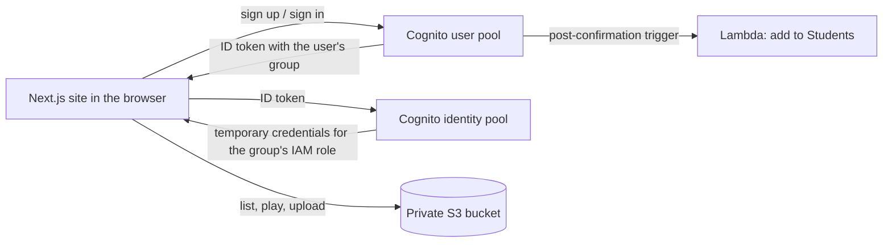

# CampusStream

CampusStream is a cloud media platform that centralizes lecture recordings, project demos and event videos. Students and faculty sign in through separate portals. Students browse and watch, and faculty can also upload videos and open usage and audit tools.

Built with **Next.js** on the front end and **AWS** (Cognito, S3, IAM, Lambda, CloudTrail, CloudWatch) on the back end. There is no custom server: the browser talks to AWS directly, with permissions decided by the user's group.

## Features

- Separate **Student** and **Faculty** portals, each with sign in and create account (email verification code).
- Role-based access using Cognito groups: students are read-only, faculty can upload.
- Folder browser over a private S3 bucket (`Courses/`, `lectures/`, `projects/`, `events/`) with an in-page video player.
- Faculty uploads with a progress bar, straight into the folder being viewed.
- Faculty shortcuts to the CloudWatch and CloudTrail consoles.
- New sign-ups are added to the `Students` group automatically by a Lambda function. Faculty access is granted manually by an administrator.

## How it connects to AWS



The repository contains **no AWS credentials**. The site only needs five IDs (below). After a user signs in, the Cognito identity pool hands the browser short-lived credentials for the IAM role matching their group (`Faculty` or `Students`), and those credentials are what let the site read or write S3.

| Piece | What it does |
|---|---|
| Cognito user pool | Accounts, passwords, email verification, `Faculty` and `Students` groups |
| Cognito identity pool | Swaps a sign-in for temporary AWS credentials, choosing the role from the group |
| IAM roles | `Students` (read-only), `Faculty` (read and upload) |
| S3 bucket | Private storage for all videos |
| Lambda | Puts every newly verified user in `Students` |
| CloudTrail, CloudWatch | Audit events and S3 usage metrics |

The full console walkthrough, every IAM policy and the Lambda code are in **[AWS-SETUP.md](./AWS-SETUP.md)**. Set up AWS first, then follow the steps below.

## Getting started

### Prerequisites

- Node.js 20 or newer and npm
- An AWS account with the resources from [AWS-SETUP.md](./AWS-SETUP.md) created in one region (the project uses `us-east-1`)

### 1. Clone and install

```bash
git clone https://github.com/Prisha67/CampusStream.git
cd CampusStream
npm install
```

### 2. Connect the site to your AWS resources

```bash
cp .env.example .env.local
```

Fill in `.env.local` with values from the AWS console:

| Variable | Where to find it |
|---|---|
| `NEXT_PUBLIC_USER_POOL_ID` | Cognito, then User pools, then your pool, then Overview |
| `NEXT_PUBLIC_USER_POOL_CLIENT_ID` | Cognito, then your pool, then App clients, then `smart-campus-web` (no client secret) |
| `NEXT_PUBLIC_IDENTITY_POOL_ID` | Cognito, then Identity pools, then `smart-campus-identity-pool` |
| `NEXT_PUBLIC_S3_BUCKET` | S3, then your bucket's name |
| `NEXT_PUBLIC_AWS_REGION` | The region of those resources, for example `us-east-1` |

`.env.local` is ignored by git. Do not commit it, and never put access keys in it.

### 3. Run

```bash
npm run dev
```

Open [http://localhost:3000](http://localhost:3000). Restart the dev server after changing `.env.local`.

### 4. Try both roles

1. **Student:** go to `/login/student`, choose **Create account**, enter the emailed code, then sign in. You should land on the dashboard with the **Student** badge and no upload button.
2. **Faculty:** register on `/login/faculty`, then in the AWS console open Cognito, then Groups, then `Faculty`, then **Add user to group**. Sign out and sign in again to see the **Faculty** badge and **Upload here** button.

Role changes apply only after a fresh sign-in.

## Project structure

```
app/
  page.tsx               public landing page
  login/                 portal chooser, student/ and faculty/ portals
  dashboard/page.tsx     folder browser, video player, faculty upload
  globals.css            theme and fonts
components/AuthForm.tsx  sign in, create account, verification, faculty gate
lib/amplify.ts           Cognito, identity pool and S3 configuration
AWS-SETUP.md             AWS console setup, IAM policies, Lambda code
.env.example             template for the five required variables
```

## Troubleshooting

| Symptom | Likely cause |
|---|---|
| `configured with secret but SECRET_HASH was not received` | App client has a secret. Create a single-page-app client with no secret |
| "Incorrect username or password" for a console-created user | The user's email is not marked verified |
| `PostConfirmation failed with error Group not found` | The `Students` group does not exist |
| `Token is not from a supported provider` | The identity pool lists a different app client |
| "Videos could not be loaded" | The user's group has no IAM role, or the role cannot list the bucket |
| Upload fails with a CORS error | The site's URL is missing from the bucket's CORS `AllowedOrigins` |

More detail is in the troubleshooting table in [AWS-SETUP.md](./AWS-SETUP.md).

## Security notes

- The bucket is private and videos play through links that expire after one hour.
- Self-registration is open to anyone with an email address. Restrict it to a college domain if needed.
- Faculty rights are granted only by an administrator through the Cognito `Faculty` group.
- CloudFront and a production domain are not configured. Add the deployed URL to the bucket CORS rule before deploying.

## Tech stack

Next.js, React, TypeScript, Tailwind CSS, AWS Amplify JS, Amazon Cognito, Amazon S3, AWS IAM, AWS Lambda, AWS CloudTrail, Amazon CloudWatch.
